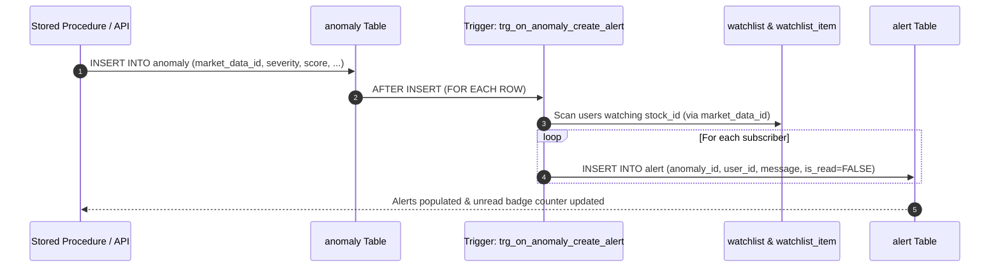

# Advanced Database Architecture & Technical Implementation

**Course:** DBMS Experiential Learning — Level 3 Project (Sem 5)  
**Institution:** PES University • Department of Computer Science & Engineering  
**Faculty Guide:** Dr. Nagasundari S (Section A)  
**Authors:** Amrit Raj Anmol (`PES2UG24CS056`) & Aman Raj (`PES2UG24CS053`)  

---

## 1. Overview of Advanced Concepts Demonstrated

As mandated by the PES University DBMS Experiential Learning Level 3 rubric, this system demonstrates mastery over **five distinct advanced database concepts**:

```
+-----------------------------------------------------------------------------------------+
|                  ADVANCED DATABASE CONCEPTS IMPLEMENTED IN MARKETGUARD                  |
+-----------------------------------------------------------------------------------------+
|  1. Vector Similarity Search (PostgreSQL 17 pgvector HNSW Cosine Indexing)              |
|  2. Stored Procedures & Analytical Window Functions (Z-Score & Volume Deviations)       |
|  3. Automated Database Event Triggers (AFTER INSERT Watchlist Anomaly Propagation)      |
|  4. Analytical Rollup Views (Multi-level Aggregations, Spread % & Sector Breadth)       |
|  5. ACID Transactions, Multi-Table Integrity Constraints & Cascading References        |
+-----------------------------------------------------------------------------------------+
```

---

## 2. Deep Dive: pgvector HNSW Vector Similarity Search

### A. Mathematical Formulation
Textual data (financial news headlines and event summaries) are mapped into a dense metric space $\mathbb{R}^{384}$ using the pretrained `sentence-transformers/all-MiniLM-L6-v2` transformer model.

Given a query vector $\vec{q} \in \mathbb{R}^{384}$ and an article embedding vector $\vec{d} \in \mathbb{R}^{384}$:

$$\text{Cosine Similarity}(\vec{q}, \vec{d}) = \frac{\vec{q} \cdot \vec{d}}{\|\vec{q}\|_2 \|\vec{d}\|_2} = \frac{\sum_{i=1}^{384} q_i d_i}{\sqrt{\sum_{i=1}^{384} q_i^2} \sqrt{\sum_{i=1}^{384} d_i^2}}$$

In PostgreSQL with `pgvector`, the cosine distance operator is denoted by `<=>`:

$$\text{Cosine Distance}(\vec{q}, \vec{d}) = 1 - \text{Cosine Similarity}(\vec{q}, \vec{d})$$

For unit-normalized vectors ($\|\vec{q}\|_2 = \|\vec{d}\|_2 = 1$):

$$\text{Cosine Distance} = 1 - (\vec{q} \cdot \vec{d})$$

### B. HNSW Index Architecture
Instead of naive linear scanning $O(N)$ or IVFFlat clustering (which requires full index rebuilding and re-training), our schema creates a **Hierarchical Navigable Small World (HNSW)** index:

```sql
CREATE INDEX idx_news_embedding
    ON news_article
    USING hnsw (embedding vector_cosine_ops)
    WITH (m = 16, ef_construction = 64);
```

- **Multi-layer Graph Structure:** Top layers possess sparse links for rapid long-range navigation; lower layers contain dense clusters for fine-grained local convergence.
- **Search Complexity:** Logarithmic search time $O(\log N)$, allowing sub-5 millisecond similarity queries across tens of thousands of vectorized market events.
- **No Training Phase:** Unlike IVFFlat, HNSW supports continuous online `INSERT` operations without degrading recall or requiring cluster re-indexing.

### C. Relational-Vector Hybrid Query (`fn_match_news_semantic`)
Rather than relying on an external disconnected vector DB (such as Pinecone or Qdrant), PostgreSQL enables atomic hybrid queries combining relational joins with vector distance ordering:

```sql
CREATE OR REPLACE FUNCTION fn_match_news_semantic(
    p_query_embedding VECTOR(384),
    p_threshold NUMERIC DEFAULT 0.20,
    p_limit INT DEFAULT 10
)
RETURNS TABLE (
    article_id BIGINT,
    source VARCHAR(150),
    title VARCHAR(500),
    article_url VARCHAR(1000),
    published_at TIMESTAMP,
    content TEXT,
    cosine_distance NUMERIC,
    similarity_score NUMERIC,
    linked_events JSONB
)
AS $$ ... $$
```

---

## 3. Statistical Anomaly Detection & Window Functions

### A. Sliding Window Formulation
The stored procedure `sp_detect_market_anomalies(p_trade_date DATE, p_std_dev_threshold NUMERIC)` computes 20-day trailing statistics without lookahead bias using analytical window clauses:

$$\text{SMA}_{20}(t) = \frac{1}{20} \sum_{i=1}^{20} P_{t-i}$$

$$\sigma_{20}(t) = \sqrt{\frac{1}{19} \sum_{i=1}^{20} \left( P_{t-i} - \text{SMA}_{20}(t) \right)^2}$$

$$\text{Z-Score}(t) = \frac{P_t - \text{SMA}_{20}(t)}{\sigma_{20}(t)}$$

$$\text{Volume Ratio}(t) = \frac{V_t}{\overline{V}_{20}(t)}$$

In SQL:
```sql
AVG(md.close_price) OVER (
    PARTITION BY md.stock_id 
    ORDER BY md.trade_date 
    ROWS BETWEEN 20 PRECEDING AND 1 PRECEDING
) AS sma_20,
STDDEV_SAMP(md.close_price) OVER (
    PARTITION BY md.stock_id 
    ORDER BY md.trade_date 
    ROWS BETWEEN 20 PRECEDING AND 1 PRECEDING
) AS std_20
```

### B. Anomaly Severity Classification
| Condition | Classification | Severity | Score Formula |
| :--- | :--- | :---: | :--- |
| $Z_t \le -3.0$ and $V_{\text{ratio}} \ge 3.0$ | `FLASH_CRASH_COLLAPSE` | `CRITICAL` | $1.5 \cdot \|Z_t\| + V_{\text{ratio}}$ |
| $Z_t \le -2.0$ | `ABNORMAL_PRICE_DROP` | `HIGH` | $\|Z_t\| + 0.5 \cdot V_{\text{ratio}}$ |
| $Z_t \ge +3.0$ | `SPECULATIVE_SURGE` | `HIGH` | $Z_t + 0.4 \cdot V_{\text{ratio}}$ |
| $V_{\text{ratio}} \ge 2.5$ | `UNUSUAL_VOLUME_OUTLIER` | `MEDIUM` | $V_{\text{ratio}} + 0.3 \cdot \|Z_t\|$ |

---

## 4. Automated Database Triggers (`trg_on_anomaly_create_alert`)



### Key Trigger Code:
```sql
CREATE OR REPLACE FUNCTION fn_create_anomaly_alert()
RETURNS TRIGGER LANGUAGE plpgsql AS $$
DECLARE
    v_stock_id INT;
    v_ticker VARCHAR(20);
    v_trade_date DATE;
    v_close_price NUMERIC(18,6);
    v_rec RECORD;
BEGIN
    SELECT md.stock_id, s.ticker, md.trade_date, md.close_price
    INTO v_stock_id, v_ticker, v_trade_date, v_close_price
    FROM market_data md
    JOIN stock s ON md.stock_id = s.stock_id
    WHERE md.market_data_id = NEW.market_data_id;

    FOR v_rec IN (
        SELECT DISTINCT w.user_id
        FROM watchlist w
        JOIN watchlist_item wi ON w.watchlist_id = wi.watchlist_id
        WHERE wi.stock_id = v_stock_id
    ) LOOP
        INSERT INTO alert (anomaly_id, user_id, alert_type, message, is_read, created_at)
        VALUES (
            NEW.anomaly_id,
            v_rec.user_id,
            NEW.anomaly_type,
            FORMAT('[%s ALERT] %s triggered %s on %s. Score: %s.',
                   NEW.severity_level, v_ticker, NEW.anomaly_type, v_trade_date, NEW.score),
            FALSE,
            CURRENT_TIMESTAMP
        );
    END LOOP;
    RETURN NEW;
END;
$$;
```

---

## 5. Analytical Views & Materialized Rollups

Three specialized SQL views abstract high-frequency analytical queries for dashboards:

1. **`vw_stock_daily_stats`:**
   Computes daily return %, intraday spread percentage $((High - Low) / Open \times 100)$, 20-day moving average, and volume surge factor per trading day.
2. **`vw_market_overview`:**
   Performs multi-table sector-level aggregation joining `sector`, `company`, `stock`, `market_data`, and `anomaly` to deliver daily turnover, advancing vs. declining stock counts, and sector anomaly counts.
3. **`vw_anomaly_audit_feed`:**
   Pre-joins `anomaly`, `anomaly_indicator_value`, `market_data`, `stock`, and `company` for instant lookups in audit dashboards without repetitive nested subqueries.

---

## 6. ACID Transactions & Schema Integrity

1. **Atomicity:** Anomaly detection, multi-indicator logging, and alert creation operate within managed database transactions. If any check constraint fails, the entire transaction rolls back cleanly.
2. **Consistency:** Enforced by 18 foreign keys, composite unique constraints (`uq_market_data_stock_date`, `uq_watchlist_user_name`), and strict checks on non-negative price values and valid severity enum domains.
3. **Isolation:** PostgreSQL Multi-Version Concurrency Control (MVCC) with Read Committed default isolation ensures high-throughput concurrent readers (Next.js client pool) do not block background Python ETL batches.
4. **Durability:** Write-Ahead Logging (WAL) ensures all committed market data points and vector embeddings survive system reboots or power loss.
